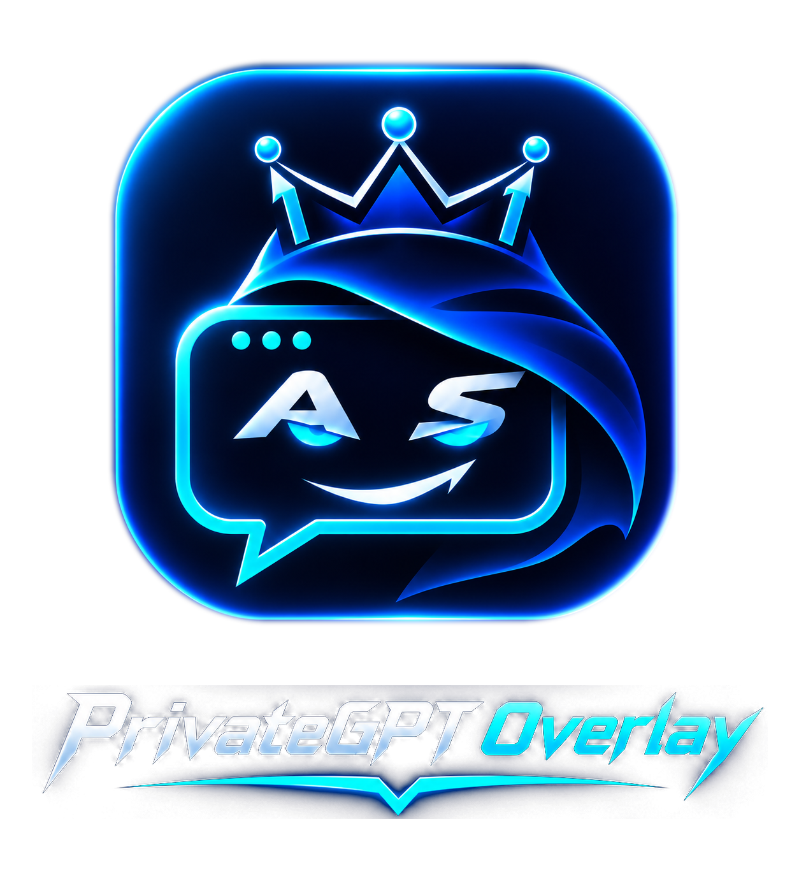
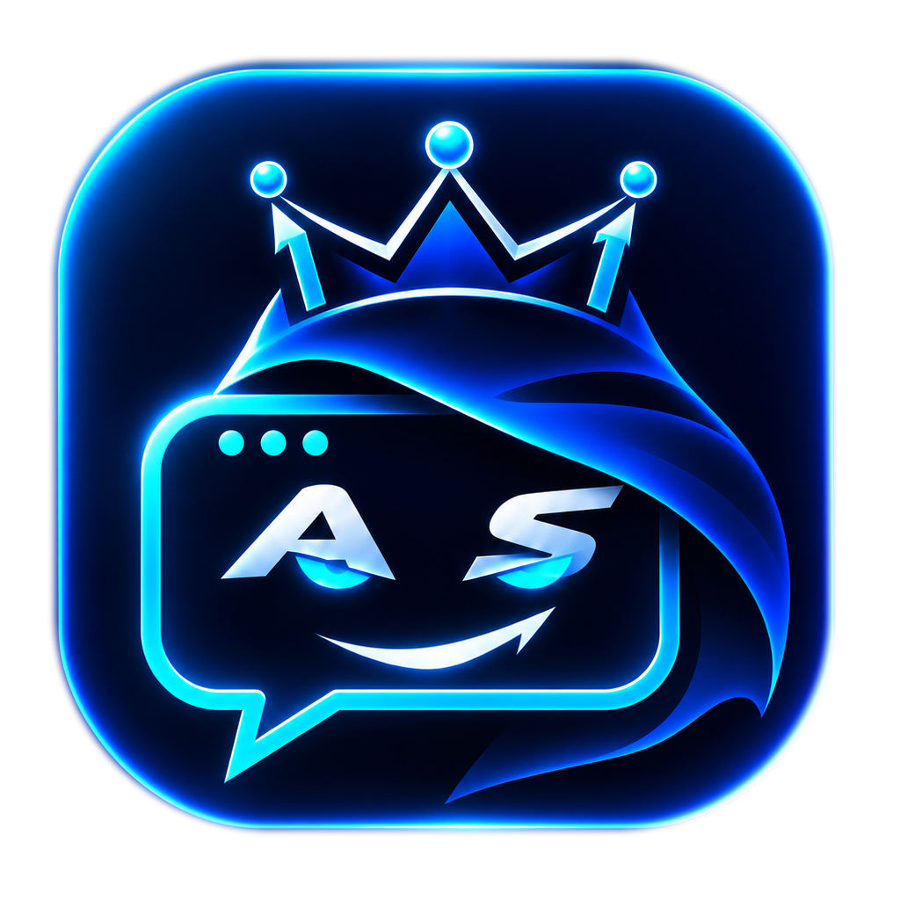
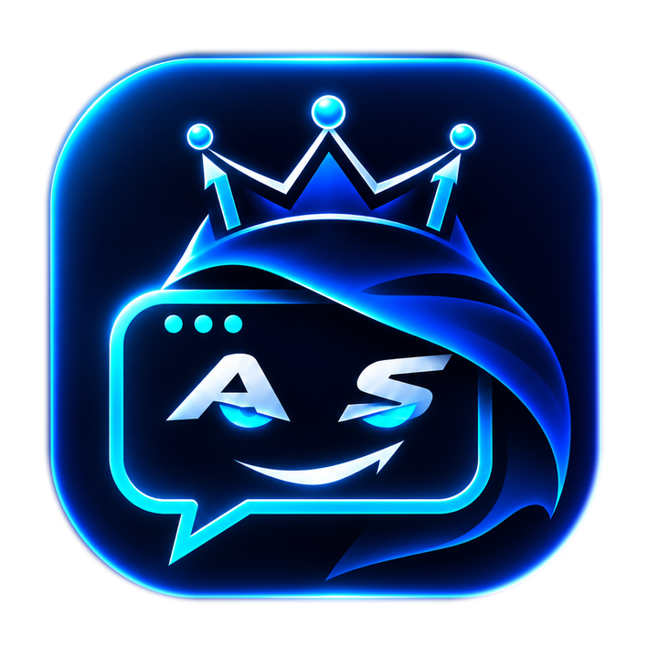
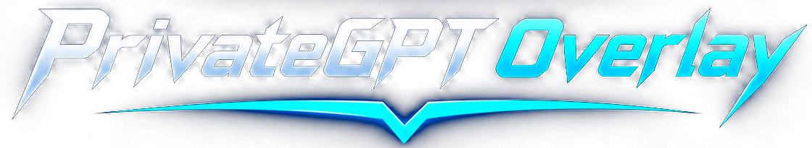

  
   
  <strong>PrivateGPT Overlay</strong> 
  Native macOS ChatGPT companion · Audio mixing · One-key desktop screenshots
    
  
  
  
  

---

PrivateGPT Overlay is a lightweight, floating **ChatGPT web window** for macOS. It uses your regular ChatGPT sign-in at [chatgpt.com](https://chatgpt.com/), not the OpenAI API. It also provides a one-key **Normal / PrivateGPT Audio** switch so ChatGPT can hear both your Mac's audio and your microphone, while you can still hear the Mac through its speakers. A separate hotkey copies a desktop screenshot straight to your clipboard.

Built with Swift, AppKit, WebKit, CoreAudio and ScreenCaptureKit. No Electron runtime, no API key, and no subscription to a separate audio-routing service.

> [!IMPORTANT]
> **Screen-share visibility is not guaranteed.** The floating panel requests legacy AppKit window-sharing exclusion, and the screenshot feature attempts to exclude this app's own windows, but capture and conferencing applications may ignore those requests. **Verify what viewers can actually see** before sharing confidential content. The app cannot suppress macOS privacy indicators, permission dialogs or another application's capture behavior.

## Contents

- [Features](#features)
- [Requirements](#requirements)
- [Install the additional apps and drivers](#install-the-additional-apps-and-drivers)
- [Configure the audio devices once](#configure-the-audio-devices-once)
- [Build and install PrivateGPT Overlay](#build-and-install-privategpt-overlay)
- [Keyboard shortcuts](#keyboard-shortcuts)
- [Audio modes and Settings](#audio-modes-and-settings)
- [Desktop screenshots and permissions](#desktop-screenshots-and-permissions)
- [Troubleshooting](#troubleshooting)
- [Project structure and branding](#project-structure-and-branding)
- [Privacy, compatibility and limitations](#privacy-compatibility-and-limitations)

## Features

| Feature | What it does |
| --- | --- |
| Floating ChatGPT | WebKit window using your existing account, chat history and the website's available features |
| Global overlay shortcut | Show or hide the panel without opening a normal Dock app |
| One-key audio switch | Toggle macOS input/output between everyday devices and the configured mixed-audio setup |
| Mic + Mac audio | Ladiocast mixes the microphone and BlackHole 2ch into BlackHole 16ch for ChatGPT |
| Hear your Mac | Multi-Output Device sends system sound to Mac speakers **and** BlackHole 2ch |
| Speaker-volume control | Dedicated Settings slider (65% default); restores the previous speaker volume when switching back |
| Native Settings | AppKit translucent materials, system controls, branded header, optional automatic switching |
| Menu bar control | Status icon with audio switching, Settings, overlay and Quit; can be hidden in Settings |
| Screenshot → clipboard | Control + Option + 3 captures all connected displays using native ScreenCaptureKit (macOS 14+) |
| Native macOS permissions | User-controlled microphone, camera and screen-capture permissions; no hidden permission bypass |

### Brand assets

  
  &nbsp;&nbsp;&nbsp;
  
  &nbsp;&nbsp;&nbsp;
  

Application icon · In-app mark · Menu bar artwork

## Requirements

- **macOS 13 Ventura or later** is the build's deployment target. **macOS 15** on an Intel Mac has been used for the approved workflow; other macOS releases and Apple Silicon are **not fully verified**.
- **macOS 14 or later** is required for the in-process desktop screenshot feature (ScreenCaptureKit's \`SCScreenshotManager\`). On macOS 13 the rest of the application can run, but that shortcut does not capture.
- Xcode or **Xcode Command Line Tools** (Swift compiler, \`codesign\` and \`xcrun\`) to build from source.
- Internet connectivity and an ordinary **ChatGPT account**.
- For **mixed microphone + system audio**: **BlackHole 2ch**, **BlackHole 16ch** and **Ladiocast**. These are installed separately, not bundled with this repository.
- A valid **Apple Development signing identity** is strongly recommended if you rebuild frequently, because it keeps the macOS Screen Recording permission identity stable. Without one, \`build.sh\` falls back to ad-hoc signing; you may need to approve screen capture again after each rebuild.

**No API key is required.** ChatGPT features and usage limits are determined by your ChatGPT account and the website, not by this app. This app is **not** an offline or local LLM.

## Install the additional apps and drivers

### 1. Developer tools and Git

Run in **Terminal**:

~~~bash
xcode-select --install
xcrun swift --version
git --version
~~~

If the command-line tools are already installed, the first command may report that. You do not need to reinstall them.

### 2. BlackHole 2ch + 16ch

Official developer: [Existential Audio / BlackHole](https://existential.audio/blackhole/). The two drivers are different devices and **both are needed** for this configuration.

If you already use [Homebrew](https://brew.sh/):

~~~bash
brew install --cask blackhole-2ch blackhole-16ch
~~~

If Homebrew is not installed, install it from [brew.sh](https://brew.sh/) first, or get the signed BlackHole packages directly from the developer's site. You do **not** need Homebrew just to run PrivateGPT.

**Restart your Mac after installing BlackHole.** Verify installation:

~~~bash
ls -d /Library/Audio/Plug-Ins/HAL/BlackHole*.driver
pkgutil --pkgs | grep -i blackhole
~~~

You should see a BlackHole 2ch driver and a BlackHole 16ch driver. BlackHole is a **virtual audio driver**, not an app with its own normal GUI.

Official Homebrew references: [BlackHole 2ch](https://formulae.brew.sh/cask/blackhole-2ch) · [BlackHole 16ch](https://formulae.brew.sh/cask/blackhole-16ch).

### 3. Ladiocast (audio mixer)

Install the free [Ladiocast app from Apple's Mac App Store](https://apps.apple.com/us/app/ladiocast/id411213048?mt=12):

~~~bash
open "https://apps.apple.com/us/app/ladiocast/id411213048?mt=12"
~~~

Choose **Get / Install** in the App Store. Then open it:

~~~bash
open -a Ladiocast
~~~

Use the **Mixer (Mixeur)** window. **You do not need Ladiocast's experimental Loopback Streamer** for this project: the proven configuration sends Ladiocast's Master output to **BlackHole 16ch**.

## Configure the audio devices once

**This part is essential.** Installing the software alone does not create the working routing. Follow these steps once; PrivateGPT then switches the default audio devices for you.

### A. Create a Multi-Output Device

~~~bash
open -a "Audio MIDI Setup"
~~~

In **Audio MIDI Setup** (French: *Configuration audio et MIDI*):

1. If necessary, open **Window → Show Audio Devices** (*Fenêtre → Afficher les périphériques audio*).
2. Click the bottom-left **+** → **Create Multi-Output Device** (*Créer un périphérique à sortie multiple*).
3. Check **MacBook Pro Speakers** (*Haut-parleurs MacBook Pro*) and **BlackHole 2ch**.
4. Make the **MacBook speakers the primary / clock source** and enable **Drift Correction** for BlackHole 2ch (not the primary speakers).
5. Set both devices to a compatible sample rate, preferably **48,000 Hz**.
6. Leave **BlackHole 16ch unchecked** in this Multi-Output Device.

The app recognizes the exact macOS names **Multi-Output Device** or **Périphérique à sortie multiple**. For audio input it recognizes **BlackHole 16ch**.

### B. Configure Ladiocast

Set the **Mixer / Mixeur** as follows:

| Ladiocast control | Device or action |
| --- | --- |
| **Input 1 / Entrée 1** | \`BlackHole 2ch\` — sound from other Mac apps |
| **Input 2 / Entrée 2** | \`Micro MacBook Pro\` — your physical microphone |
| **Input 1 → Master** | **Enabled** |
| **Input 2 → Master** | **Enabled** |
| **Main output / Sortie master** | \`BlackHole 16ch\` |
| **Aux 1 / Aux 2 / Aux 3** | Not needed |

Play a video and speak into the microphone: **Ladiocast's Master meter should move for both**. It is possible for an input meter to move while that input is *not* routed to Master—verify both Master routing buttons.

Do **not** send Ladiocast's mixed Master output to the speakers. The microphone should go to ChatGPT, **not back to your ears**. The speakers receive normal Mac audio through the Multi-Output Device instead.

### C. Understand the working signal flow

~~~text
Mac apps (video / meeting audio) ──> Multi-Output Device
                                        │
                          ┌─────────────┴───────────────┐
                          ▼                             ▼
                  MacBook speakers                BlackHole 2ch
                  (you hear Mac)                        │
                                                        ▼
MacBook microphone ────────────────────> Ladiocast mixer (Master)
                                                        │
                                                        ▼
                                                  BlackHole 16ch
                                                        │
                                                        ▼
                                             PrivateGPT / ChatGPT mic
~~~

After this one-time setup, **leave Ladiocast running** while using PrivateGPT mixed audio. The application can attempt to launch Ladiocast in the background, but Ladiocast must have its inputs and routing set correctly.

### D. Quick verification

- With YouTube playing, you should **hear the video** through the speakers.
- With ChatGPT dictation running, it should **hear the video and your own microphone**.
- Pausing YouTube and speaking should still move Ladiocast's Master output meter.
- You should **not hear your own voice as direct software monitoring**. Speakers can still leak acoustically into the mic; headphones are preferable when echo matters.
- In a real meeting, set the **meeting app's microphone to your physical microphone**, not BlackHole 16ch, to avoid sending the meeting audio back into the call.

See BlackHole's official [Multi-Output Device guide](https://github.com/ExistentialAudio/BlackHole/wiki/Getting-Started%3A-Creating-a-Multi-Output-Device).

## Build and install PrivateGPT Overlay

### Clone this repository

~~~bash
git clone https://github.com/AbdelaliSaadali/PrivateGPT_Overlay.git
cd PrivateGPT_Overlay
chmod +x build.sh install.sh
~~~

### Install to Applications

~~~bash
./install.sh
~~~

The script compiles a native Swift app, copies the tracked branding assets, signs the executable, and installs to:

\`/Applications/PrivateGPT Overlay.app\`

**It does not launch the app or change your current audio settings.** Launch whenever ready:

~~~bash
open "/Applications/PrivateGPT Overlay.app"
~~~

### Build without installing

~~~bash
./build.sh --no-open
~~~

Output: \`build/PrivateGPTOverlay.app\`. The install script checks for a running installed app; **quit PrivateGPT before updating**.

### Verify the installed build

~~~bash
/usr/libexec/PlistBuddy -c 'Print CFBundleShortVersionString' \
  "/Applications/PrivateGPT Overlay.app/Contents/Info.plist"

codesign --verify --deep --strict \
  "/Applications/PrivateGPT Overlay.app"

codesign -d -vv "/Applications/PrivateGPT Overlay.app" 2>&1 \
  | grep -E '^Identifier=|^Authority=|^TeamIdentifier='
~~~

Version **0.3.6** is the microphone-permission maintenance update on top of the approved v0.3.5 source release. This is a **locally built and signed app, not a notarized public binary distribution**.

## Keyboard shortcuts

| Shortcut | Function |
| --- | --- |
| **Control + Option + Space** (\`⌃⌥Space\`) | Show / hide ChatGPT Overlay |
| **Control + Option + M** (\`⌃⌥M\`) | Switch Normal Audio ↔ PrivateGPT Audio |
| **Control + Option + 3** (\`⌃⌥3\`) | Copy desktop screenshot to clipboard (macOS 14+) |
| **Control + Option + S** (\`⌃⌥S\`) | Open Settings |
| **Control + Option + ,** (\`⌃⌥,\`) | Alternative Settings shortcut |
| **Control + Option + Q** (\`⌃⌥Q\`) | Quit the app |
| **Command + ,** (\`⌘,\`) | Settings when the app's menu is active |
| **Command + C / V** (\`⌘C / ⌘V\`) | Copy / paste text or clipboard screenshots in the WebView |

Shortcuts are **registered by PrivateGPT while it is running** and unregistered on exit. They do not alter your permanent macOS keyboard shortcuts. Keyboard layouts and shortcuts from other applications can conflict.

## Audio modes and Settings

Open Settings with **⌃⌥S**, or use the branded menu bar icon → **Settings…**.

**Normal Audio** uses your previously selected input/output devices. **PrivateGPT Audio** chooses:
- macOS output → **Multi-Output Device** (speakers + BlackHole 2ch).
- macOS input → **BlackHole 16ch** (microphone + Mac sound after Ladiocast mixing).
- Speaker hardware volume → your configured **PrivateGPT volume**, initially **65%**.

When you restore Normal Audio, the app restores the previously recorded speaker volume and available input/output devices. If a saved device is unavailable after restart, it falls back to built-in MacBook devices.

Native Settings also includes:
- **Automatic audio mode** when you show the overlay (off by default).
- **Restore everyday audio** on hide when automatic switching is enabled and on quit (on by default).
- **Menu bar icon** visibility (on by default); useful if you do not want the app's extra menu bar icon on a shared screen.
- **Remember ChatGPT microphone approval** (on by default): WebKit grants microphone requests from the exact secure `https://chatgpt.com` origin without repeating its website prompt. Camera access and other websites always retain their normal prompts, and macOS system-level microphone permission can still be revoked in Privacy & Security → Microphone.
- **Refresh** device state and **Open Ladiocast**.

macOS Multi-Output devices commonly disable the usual keyboard volume slider. Adjust **Speaker volume during PrivateGPT Audio** in Settings instead.

## Desktop screenshots and permissions

**⌃⌥3** captures the desktop, including multiple displays, directly to the **clipboard**. It creates **no local screenshot file**, plays no app shutter sound and shows no app screenshot thumbnail. Open a compatible destination and press **⌘V**.

The capture is performed **inside PrivateGPT Overlay** by Apple's **ScreenCaptureKit**, not by launching \`/usr/sbin/screencapture\`. ScreenCaptureKit attempts to exclude PrivateGPT's own windows; **do not assume this works in every screen-sharing application**.

### First-time screen recording permission

1. Open the **installed** \`/Applications/PrivateGPT Overlay.app\`.
2. Press **⌃⌥3**.
3. If prompted, open **System Settings → Privacy & Security → Screen & System Audio Recording** (*Confidentialité et sécurité → Enregistrement de l'écran et des sons du système*).
4. Enable **PrivateGPT Overlay**.
5. **Fully quit** the app with **⌃⌥Q**, then reopen it and retry **⌃⌥3**.
6. Paste into Notes or ChatGPT to check that the clipboard contains the image.

**Do not bypass or suppress macOS permission controls.** System-supplied prompts and privacy indicators are outside the app's control.

### Permission appears enabled but capture is denied

Earlier ad-hoc-signed builds could leave stale macOS **TCC** permissions tied to an old code hash. The approved v0.3.5 build uses a stable **Apple Development certificate** when one is installed.

Only if the permission remains broken, quit PrivateGPT and reset **only its** ScreenCapture authorization:

~~~bash
tccutil reset ScreenCapture local.prototype.privategptoverlay
~~~

Then open the installed app and follow the first-time permission steps above. This reset does **not** target other apps. Never manually edit the protected TCC database.

### Microphone and camera

**Microphone approval (v0.3.6):** PrivateGPT remembers your prior approval for **microphone-only requests from `https://chatgpt.com`** by default, avoiding the same WebKit permission prompt on each app launch. This does **not** grant camera access, allow other websites, or bypass macOS's own microphone permission. Disable **Settings → Behavior → Remember ChatGPT microphone approval** to restore the per-request website prompt at any time.

When using ChatGPT voice/dictation, choose the intended **system default input**; if dictation was already active when you toggled audio modes, stop and restart it so the WebView uses the updated audio device.

## Troubleshooting

| Symptom | Check / repair |
| --- | --- |
| ChatGPT hears YouTube but not your voice | Ladiocast **Input 2 = MacBook microphone**, **Input 2 → Master enabled**. Verify the Master meter moves when speaking with the video paused. |
| ChatGPT hears nothing | Ladiocast running, Main Output = **BlackHole 16ch**, both inputs routed to Master, macOS default input = BlackHole 16ch; restart dictation after switching. |
| You cannot hear the Mac | Multi-Output Device includes **speakers + BlackHole 2ch**, with speakers as clock source. Adjust the physical speaker volume in PrivateGPT Settings. |
| You hear your own voice / feedback | Do not output Ladiocast Master to the speakers. Use headphones and make sure meeting mic uses **physical mic**, not the virtual mixed input. |
| Sound crackles / drifts | Use 48 kHz across devices; set speakers as the clock source, BlackHole 2ch with Drift Correction. |
| Audio shortcut doesn't work | Check PrivateGPT is running; verify device names, especially if macOS uses a non-French locale or different speaker/mic names. |
| Settings won't open | Try **⌃⌥S** or the menu icon. The Settings layout avoids the conflicting AppKit constraints that caused an earlier crash. |
| ChatGPT asks for microphone on every launch | In Settings → Behavior, enable **Remember ChatGPT microphone approval**. This applies only to microphone-only requests from the exact HTTPS `chatgpt.com` origin; it doesn't affect macOS microphone permission. |
| Screenshot doesn't paste | Check macOS Screen Recording permission, fully quit/reopen after granting, confirm macOS 14+, try pasting into Notes. See the TCC reset instructions above. |
| Old app icon appears | Quit the app, reinstall; the build now uses \`PrivateGPTCrowned.icns\` and re-registers the app. The Dock may need refreshing. |
| Window appears in a screen share | Window-sharing exclusion is best-effort. Test the **recipient's actual view** and follow the meeting's privacy rules. |

**Existing user session:** The app uses a persistent WebKit website data store. It does not read or export your credentials, but website cookies and other WebKit data are managed locally by macOS. Avoid uploading that data to a repository.

## Project structure and branding

~~~text
PrivateGPT_Overlay/
├── PrivateGPTOverlay.swift        # WebKit panel, app lifecycle, shortcuts
├── AudioRouting.swift             # CoreAudio defaults and speaker volume
├── AudioControls.swift            # Menu bar and translucent Settings
├── DesktopClipboardCapture.swift  # ScreenCaptureKit + clipboard
├── Info.plist                     # macOS bundle metadata / permissions
├── Entitlements.plist             # Audio and camera capabilities
├── build.sh                       # Build and sign locally
├── install.sh                     # Install into /Applications
├── Assets/
│   ├── AppIcon.icns               # Approved macOS crowned app icon
│   └── Brand/                     # Approved logo variations
│       ├── AppIcon_1024.png
│       ├── Approved_Master.png
│       ├── Full_Logo_Transparent.png
│       ├── InApp_Badge.png
│       ├── MenuBarTemplate.png
│       ├── MenuBarTemplate@2x.png
│       ├── MenuBarTemplate@4x.png
│       ├── Welcome_Banner.png
│       └── Wordmark_Transparent.png
├── scripts/
│   ├── prepare_brand.py           # Prepare selected files from original branding kit
│   └── generate_icon.py           # Original icon generation helper
└── README.md
~~~

**The blue/black mascot, crowned AS artwork and wordmark are the project's approved branding.** The corrected monochrome menu bar design becomes an AppKit **template image**, allowing automatic contrast in light and dark menu bars.

The original \`PrivateGPT_Overlay_Brand_Kit/\` folder is kept locally by the owner but excluded from Git. All required **selected app assets** are already committed in \`Assets/Brand\`, so cloning this repository does **not** require that separate kit.

## Privacy, compatibility and limitations

- This project is an **unofficial companion** to [ChatGPT](https://chatgpt.com/), not an OpenAI product and not affiliated with or endorsed by OpenAI.
- No OpenAI API key is requested or used; account access is governed by ChatGPT's own website.
- The app does **not save desktop screenshots or microphone recordings to files**. A screenshot remains on the system clipboard until replaced or cleared.
- macOS permissions are requested through the normal system mechanisms. The app never silently approves them.
- The app deliberately disables common WebRTC audio-processing options for the virtual mixed microphone, which can increase acoustic echo. Configure speakers and your microphone responsibly.
- macOS 13 is the compilation target; native screenshots require macOS 14+. The approved build was used on **Intel macOS 15**; cross-version/Apple Silicon behavior should be tested before distribution.
- Screen-sharing concealment, microphone routing, and available ChatGPT website features can vary by macOS version, meeting software and ChatGPT updates.
- **Source repository, not a notarized installer.** Build locally and review the source before running it on another Mac. The presence of source code on GitHub does not itself grant reuse or redistribution rights without an explicit license.

---

  
   
  Designed and developed for macOS · v0.3.6

